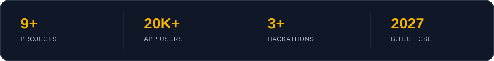
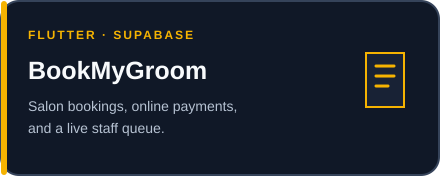
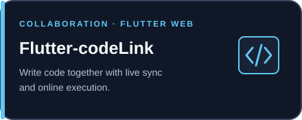
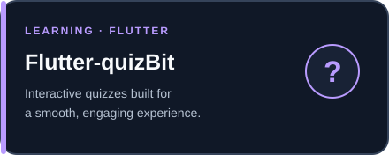

  
    
  
  
  

 

  

### A few things I build with

  
  
  
  
  
  

### Selected projects

  
  
  

### GitHub activity

  

  

Open to Flutter internships, freelance projects, and exciting collaborations.

[Explore all my projects →](https://github.com/shikhar11x?tab=repositories)

